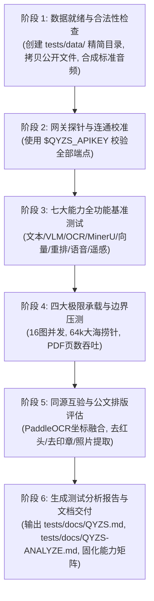

# 自然资源部庆阳智算中心大模型测试方案（QYZS-TESTPLAN）

> **文档标识**：QYZS-TESTPLAN-2026-V1.0  
> **制定单位**：自然资源部信息中心 / 庆阳智算中心项目研发组  
> **适用范围**：面向庆阳大模型协同工作平台（国土空间基础信息平台）全量模型的基准连通性、业务功能、同源互验与极限边界压测  
> **测试专用认证凭证**：`Authorization: Bearer $QYZS_APIKEY`（通过环境变量 `QYZS_APIKEY` 注入，本文档已脱敏）

---

## 1. 测试目标与核心原则

### 1.1 测试目标
1. **全面探查模型真值**：针对官方手册与控制台中的模型离线、代码拼写错误、端点变更等问题进行 100% 探针实测，建立经检验的高可用模型清单。
2. **同源互验与业务对齐**：建立 OCR 与 PDF/DOC 文档同源对齐数据对，实现行级坐标检测与结构化 Markdown 互验，完成公文去红头、去印章和照片附件提取的技术验证。
3. **极限承载边界探查**：压测多图并发（1~16+ 图）、长上下文（2k~64k Tokens 大海捞针召回率）以及 PDF 文件页数吞吐，确立客户端自动切换降级策略。
4. **固化能力调度矩阵**：输出量化性能指标，固化为可配置的 `capability_matrix.toml`，为 `qyzs` 命令行与 MCP 服务提供调度依据。

### 1.2 测试原则
- **公开合规原则**：所有文档、图片、表格样本均为**合成测试样本**（文献名称与文号已脱敏，编号统一替换为 `SAMPLE-XXXX`），坚决不使用任何涉密或内部可研材料。
- **同源互验原则**：`ocr/` 图像与 `mineru/` PDF 来自同一批测试样本，确保版面与像素一一对应。
- **客观极限原则**：对并发图片数、长上下文长度实施梯度压力测试，直至触发断点。

---

## 2. 测试环境与基准配置

### 2.1 网关端点配置
- **公共模型网关 Base URL**：`http://59.219.113.13:9200/api/aiCenterChat/v1`
- **MinerU 专属网关 Base URL**：`http://59.219.113.13:9200/ai-gateway/mineru3.2.3`
- **OCR 引擎（paddleocrvl）**：走公共模型网关 `/api/aiCenterChat/v1/chat/completions`，`model=paddleocrvl`。
  注：旧 Triton 端点 `…/ai-gateway/mymodel-paddleocr-udhyfg/v2/models/ocr/infer` 对应的模型
  实测 **400 base_url_missing、禁止调度**（`capability_matrix.toml` 中 `online = false`），已废弃不可用；
- **遥感双时相流水线接口**：`http://59.219.113.13:9200/api/aiCenterChat/v3/form/acid-sam3-full`

### 2.2 认证凭证与请求规范
- **测试认证 Token**：`Authorization: Bearer $QYZS_APIKEY`（通过环境变量 `QYZS_APIKEY` 注入，已脱敏）
- **通用超时控制**：
  - 客户端只有**一个全局超时**（`network.timeout`，代码基准默认 30 秒），可经 `--timeout` / `QYZS_TIMEOUT` / 配置文件覆盖；**不按请求类型分设默认值**；
  - `markscan` 转换场景另设**下限 300 秒**（取 `max(用户超时, 300s)`，实测扫描件解析存在长尾，默认 30s 会误伤）；
  - 遥感变化流水线为异步表单接口，耗时较长，建议显式传 `--timeout 900` 以上。

---

## 3. 测试数据集架构与规划（`tests/data/`）

```
tests/data/
├── chat/                                # 纯文本长短对话与代码推理
│   ├── short_prompts.json               # 基础问答、地籍术语定义、JSON结构清洗提示词
│   ├── long_prompts.json                # 2k~8k tokens 政策条款冲突与招标法规推演
│   ├── needle_haystack_64k.json         # 32k~64k 大海捞针长上下文压力测试集
│   └── code_and_reasoning.json          # 业务计算与地理数据清洗代码生成用例
│
├── vlm/                                 # 视觉语言与多模态空间要素理解
│   ├── images/
│   │   ├── sig_seal_official.png        # 测试样张 SAMPLE-0060：联合发文红章与签字页扫描件
│   │   ├── system_arch_flowchart.png    # 测试样张 SAMPLE-0022：系统技术架构图
│   │   └── gov_cloud_flow.png           # 测试样张 SAMPLE-0005：政务云数据共享业务流转图
│   ├── multi_image_batch/               # 多图并发测试图片集：page_scan_01~10（扫描页）、
│   │                                    #   page_text_11~12（文本页）、asset_*（13~16 混排）
│   └── vlm_test_cases.json              # 空间定位与要素提取提问集
│
├── ocr/                                 # 【与 mineru 同源】高精 OCR 与文字坐标检测
│   ├── images/
│   │   ├── ref0056_p1_title.png         # [同源映射 1] 对应 mineru/text_pdf/SAMPLE-0056 发文标题页
│   │   ├── ref0101_p1_redhead_scan.png  # [同源映射 2] 对应 mineru/scanned_pdf/SAMPLE-0101 红头扫描版面
│   │   └── ref0101_p8_seal_scan.png     # [同源映射 3] 对应 mineru/scanned_pdf/SAMPLE-0101 落款红章与日期
│   └── paired_alignment_spec.json       # 像素级文字与坐标真值标注
│
├── mineru/                              # 【与 ocr 同源】MinerU 复杂版面解析
│   ├── text_pdf/
│   │   └── SAMPLE-0056_测试规章文本.pdf     # 标准矢量 PDF 测试样本（实测 200 通过）
│   ├── scanned_pdf/
│   │   └── SAMPLE-0101_红头文件扫描件.pdf   # 红头公文样式扫描测试样本（带红章）
│   └── public_doc/
│       ├── SAMPLE-0017_测试工作方案.doc     # 旧版 .doc 样本（解析网关实测拒绝，用作格式识别样本）
│       └── SAMPLE-0106_测试审查表.docx      # 符合性审查表格类测试样本（实测 200 通过）
│
├── rag/                                 # 语义向量嵌入与重排序测试集
│   ├── chunks_sample.json               # 文本向量测试集（测试 bge-m3 和 qwen3-embadding-8b）
│   └── queries_sample.json              # 依据实测 rerank 规范设计的 Query-Document 排序对
│
├── audio/                               # 语音识别基准测试集 (Qwen3-ASR)
│   ├── samples/
│   │   └── sample_speech_cmd.wav        # Python 合成 16kHz 单声道标准指令音频
│   └── audio_prompts.json               # ASR 测试用例与音频 Base64 规约
│
└── rs/                                  # 遥感语义变化检测测试规约 (ACID+SAM3)
    └── sample_aoi.geojson               # 标准测试 AOI Polygon 规约
```

> [!NOTE]
> **脱敏说明**：上表中的样本文件名与文献名称已做脱敏替换（编号统一写作 `SAMPLE-XXXX`，文献标题以《测试文献X》代称）。`tests/data/` 目录下磁盘实际文件名仍保留原始 `REF-XXXX_*` 编号，路径以 `prepare_dataset.py` 与 `validate_data.py` 为准；原始文献标题与文号均为虚构测试样本，不对应任何真实公文。

---

## 4. 极限能力与压力测试方案设计

### 4.1 压测项目 1：多图并发承载极限（VLM Multi-Image Concurrency）
- **测试模型**：`qwen3-VL-30B-A3B`, `paddleocrvl`, `qwen3.6-27b`
- **压力阶梯**：单次请求传入 1 张、4 张、8 张、12 张、16 张、24 张高清图片（Base64 封装在 `image_url` 中）。
- **验证重点**：
  1. Nginx 网关对 Body 大小的拦截阈值（`413 Request Entity Too Large`）；
  2. 显存是否溢出（OOM）或返回 `500 Server Error`；
  3. 模型多图计数准确性、各图片内容顺序识别率。

### 4.2 压测项目 2：PDF 页数与 MinerU 吞吐极限（Document Scale）
- **测试引擎**：`MinerU 3.2.3`（`/file_parse` 同步通道）
- **压力阶梯**：
  - 页数：单页、5页、15页、30页、50页、100页；
  - 文件体积：500KB、5MB、15MB、30MB、50MB。
- **自动切换基准建立**（**尚未实现，仅为待办设计**）：
  - 测定同步接口平均每页耗时与网关超时断点；
  - ~~确定 CLI 客户端从同步请求自动切换为异步轮询的阈值条件~~ —— CLI 目前**只实现同步通道**（`src/client/mineru.rs` 仅调 `/file_parse`），网关返回 `pending`/`running` 时直接报错终止，**没有 `/tasks` 端点、没有轮询循环、没有自动转异步**。要落地自动切换须先补异步通道实现。

### 4.3 压测项目 3：超长上下文与大海捞针测试（Needle in a Haystack）
- **测试模型**：`dsv4`, `qwen3.6-27b`
- **压力阶梯**：2,000 $\rightarrow$ 8,000 $\rightarrow$ 16,000 $\rightarrow$ 32,000 $\rightarrow$ 64,000 Tokens；极限上探另执行 77,795（`stress_limits.py`）与 518,438（`limit_probe*.py`）两档。
- **测试方法**：
  - 构建以真实自然资源政策法规为背景的长文本（实测 77,795 Tokens 约合 7 万字量级）；
  - 在文本的 **10%（前部）、50%（中部）、90%（尾部）** 随机插入假想批复实体信息（针）：
    > `【密级：内部工作核查】自然资源部批准重大生态修复示范工程项目，批准文号为：自然资环函〔20XX〕XXXXXX号（示例文号），核准批复面积为：7654.32公顷。`
  - 提示词要求大模型提取出批准文号与核准面积。
  - 统计两款模型在各长度、各深度下的检索命中率与幻觉发生率。
- **执行记录（2026-10-17）**：主执行轮次覆盖 **50% 深度**（`stress_limits.py` 至 77,795 Tokens；`limit_probe*.py` 梯度上探至 51.8 万 Tokens），10%/90% 深度用例保留为扩展轮次；实测结果见 `QYZS-ANALYZE.md` §3.2 与 §3.4。

### 4.4 压测项目 4：重排序候选集规模极限（Rerank Batch Scale）
- **测试模型**：`bge-reranker-v2-m3`, `qwen3-reranker-8b`
- **压力阶梯**：单次请求传入 10 篇、50 篇、100 篇候选文档。
- **测试指标**：响应延迟、排序分数单调性、网关超时情况，确立 CLI 分批重排（Chunked Reranking）的最佳切片大小。

### 4.5 压测项目 5：生成参数与输入边界极限（Parameter Boundary Probes）
- **测试模型**：`dsv4`, `qwen3.6-27b`, `qwen3-VL-30B-A3B`（文本通道）
- **压力阶梯**：
  - `max_tokens`：1 → 1,024 → 8,192 → 16,384 → 32,768 → 65,536，确定各模型接受上限与实际截断行为（`finish_reason`）；
  - `temperature`：-0.5 → 0.0 → 0.7 → 1.0 → 1.5 → 2.0 → 2.1，确定网关/模型校验边界；
  - 多图并发延伸：在 16 图基础上追加 20 图、24 图（循环复用样本图），探查网关 Body 体积与显存极限；
  - Embedding 输入长度（1k/5k/10k/20k 字符）与批量规模（16/32/64/128/256 条）；
  - Rerank 候选规模延伸至 200 篇；
  - MinerU 同步解析页数阶梯（5/15/30 页，由源 PDF 循环扩页合成）。
- **执行脚本**：`tests/scripts/limit_probe.py`（凭证经 `QYZS_APIKEY` 环境变量注入），结果输出至 `tests/scripts/limit_summary.json`。

---

## 5. 同源互验与公文排版处理验证设计

### 5.1 PaddleOCR 与 MinerU 同源互验机制
- **输入对齐**：使用 `SAMPLE-0056` 矢量 PDF 与 `SAMPLE-0101` 扫描 PDF，分别直接输入 MinerU，并提取其首页及落款页输入 paddleocrvl（经公共模型网关 `/api/aiCenterChat/v1/chat/completions`，见 §2.1）。
- **比对算法**：
  1. **文本覆盖率比对（Recall Check）**：计算 PaddleOCR 检出的所有文本行在 MinerU Markdown 中的覆盖度，验证表格内小字是否漏检；
  2. **版面几何与语义融合**：PaddleOCR 负责提供字符的 8 点多边形外接框坐标，MinerU 负责组织标题、段落与表格语义。

### 5.2 红头与印章剥离效果验证
- **去红头验证**：输入 `SAMPLE-0101` 首页扫描件，断言输出的 Markdown 中成功剔除大红横线与红头文号字样（原文号已脱敏），并将其转换为顶部 Frontmatter；
- **去印章验证**：输入 `SAMPLE-0101` 第 8 页盖章扫描件，断言输出中无红章内文字重叠乱码，并在文末正确标注公章核验信息。

---

## 6. 六阶段测试执行全流程



---

## 7. 自动化测试脚本与断言设计

- **`tests/scripts/validate_data.py`**：静态数据校验器，验证全部测试素材无损坏且同源映射正确；
- **`tests/scripts/prepare_dataset.py`**：基准数据集准备器（从离线文档语料构建 `tests/data/` 素材）；
- **`tests/scripts/run_benchmarks.py`**：全量功能基准测试执行器，生成各模型的延迟与返回结构；
- **`tests/scripts/stress_limits.py`**：极限边界测试执行器，执行多图与 64k 大海捞针，生成测试图表数据；
- **`tests/scripts/limit_probe.py`**：参数与输入边界探针，执行上下文天花板阶梯、max_tokens/temperature 边界、20/24 图并发、Embedding 长度与批量、Rerank 200 篇规模及 MinerU 页数阶梯测试（另有 `limit_probe_final.py` / `limit_probe_followup.py` / `limit_probe_round3.py` 三轮跟进）；
- **`tests/scripts/test_ocr_mineru_alignment.py`**：同源互验校对器，比对 OCR 与 MinerU 文本一致率并生成对齐报告；
- **`tests/scripts/verify_guardrails.sh`**：客户端护栏实测（5 阶段 / 7 项断言）——短文本基线、超长文本分块、短向量模型分块、300 条批量拆批、20 图自动分批（需真实网关与 `QYZS_APIKEY`）；
- **`tests/scripts/check_no_secrets.sh`**：提交历史密钥扫描（CI `secret-scan` 门禁的入口，全对象库 + 已跟踪文件）；
- **`tests/scripts/verify_release_pipeline.py`**：发布流水线本地验证（模拟 GitHub Release，验证 install.sh / `upgrade` / dataset / install.ps1 / npm 包族，39 项断言）；
- **`tests/scripts/pin_install_scripts.sh`**：把安装脚本的版本钉定到指定 tag（CI 发布时调用；tag 必须带 `v` 前缀，否则 Release 下载 URL 会 404）；
- **`tests/scripts/check_help_contract.py`**：帮助文本 ↔ 参数校验 ↔ 文档 三方一致性检查（help 是否预告校验边界/默认值/取值白名单，文档是否提到不存在的参数）。

---

## 8. 执行结果工件清单

全部原始实测数据以 JSON 形式留存于 `tests/scripts/`，报告数值均可溯源
（例外：`alignment_report.json` 只记录了 OCR 一侧耗时，MinerU 耗时未留存字段，
详见 `QYZS-ANALYZE.md` §4.1 的溯源说明）：

| 工件 | 产出脚本 | 内容 |
| :--- | :--- | :--- |
| `benchmark_summary.json` | `run_benchmarks.py` | 全模型连通性、延时、Token 用量基准 |
| `stress_summary.json` | `stress_limits.py` | 1~16 图并发、8k/32k/157k 字符大海捞针 |
| `limit_summary.json` | `limit_probe.py` | 上下文天花板阶梯、max_tokens/temperature 边界、20/24 图、Embedding 长度与批量、Rerank 10~200 篇、MinerU 5/15/30 页 |
| `limit_summary_followup.json` | `limit_probe_followup.py` | 天花板收口：bge-large-zh-v1.5 长度下探、批量分块、32 图承载、temperature 上界 |
| `limit_summary_round3.json` | `limit_probe_round3.py` | dsv4 40 万/53 万字符、qwen3-VL 20 万字符、48 图承载 |
| `limit_summary_final.json` | `limit_probe_final.py` | dsv4 70 万/105 万字符封顶、qwen3-VL 131,072 硬限确认 |
| `limit_summary_qwen36_ceiling.json` | 探针内联脚本 | qwen3.6-27b 26 万/28.5 万字符接受性与召回边界 |
| `alignment_report.json` | `test_ocr_mineru_alignment.py` | OCR 与 MinerU 同源互验 Jaccard 与关键实体召回 |

> [!NOTE]
> 所有测试/压测脚本统一经 `tests/scripts/_qyzs_env.py` 读取测试凭证：优先环境变量 `QYZS_APIKEY`，其次仓库根目录 `.env` 文件（模板见 `.env.example`，已被 `.gitignore` 排除），仓库内不落盘明文 Key。
